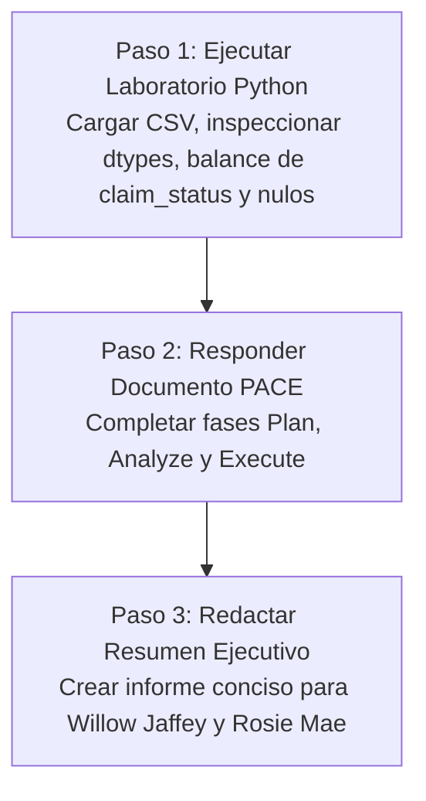

# Documento de Handoff: Proyecto TikTok (Curso 1)

[⬅ Volver al README del Proyecto](README.md) | [Documento de Trabajo (tiktok.md)](tiktok.md) | [Propuesta de Hitos](Propuesta_del_Proyecto_TikTok.md) | [Protocolo de Agentes (AGENTS.md)](AGENTS.md)

> [!IMPORTANT]
> **DIRECTIVA PARA EL AGENTE RECEPTOR:**
> Este documento contiene el estado operativo exacto, el contexto de negocio y el plan de ejecución paso a paso para desarrollar el proyecto **TikTok** en el marco del **Curso 1: Foundations of Data Science** del Certificado de Google Advanced Data Analytics. El entorno está 100% configurado y listo para resolver las tareas del hito.

---

## 1. Contexto del Negocio y Misión del Proyecto

- **Socio de la Industria:** TikTok.
- **Equipo:** Confianza y Seguridad (*Trust & Safety*).
- **Problema Comercial:** TikTok recibe un flujo masivo de denuncias de videos por presuntas violaciones a las normas comunitarias. Se necesita construir un modelo de Machine Learning y NLP que distinga entre **afirmaciones fácticas (*claims*)** y **opiniones personales (*opinions*)** para priorizar la cola de moderación humana hacia afirmaciones verificables.
- **Objetivo del Hito Actual (Curso 1):** Realizar la inspección y preparación preliminar de los datos en Python, responder al Documento de Estrategia PACE y elaborar un Resumen Ejecutivo para el liderazgo de datos de TikTok.

---

## 2. Mapa de Archivos del Proyecto

Todos los recursos se encuentran organizados localmente dentro de este directorio (`Advanced Data Analytics/proyectos/02_TikTok_Project/`):

| Archivo | Función / Contenido | Estado |
| :--- | :--- | :---: |
| **`HANDOFF_TIKTOK.md`** | Este documento de transferencia y guía de ejecución. | `Completado` |
| **`README.md`** | MOC del proyecto con enlaces de navegación a todos los artefactos. | `Completado` |
| **`AGENTS.md`** | Directivas operativas para agentes y autorización de lectura externa. | `Completado` |
| **`tiktok.md`** | Notas de contexto, equipo de trabajo, correos electrónicos y diccionario de 12 columnas. | `Formateado y listo` |
| **`Propuesta_del_Proyecto_TikTok.md`** | Matriz oficial de hitos, entregables y partes interesadas para los 6 cursos. | `Completado` |
| **`PACE_Strategy_Document_TikTok.md`** | Documento de estrategia PACE con respuestas a las fases Plan, Analyze y Execute. | `Completado` |
| **`Resumen_Ejecutivo_TikTok_Curso1.md`** | Informe ejecutivo para el liderazgo de datos de TikTok (Willow Jaffey y Rosie Mae Bradshaw). | `Completado` |
| **`Activity_Course 2 TikTok project lab.ipynb`** | Cuaderno guiado oficial de Jupyter con código, outputs ejecutados y respuestas. | `Completado y ejecutado` |
| **`tiktok_dataset.csv`** | Conjunto de datos oficial de TikTok (videos reportados y métricas). | `Disponible localmente` |
| **`images/`** | Diagramas de las fases PACE requeridos por el cuaderno de Jupyter. | `Disponible localmente` |
| **`task.md`** | Checklist atómica de seguimiento del hito del Curso 1. | `Completado` |
| **`../Plantilla_Resumen_Ejecutivo.md`** | Plantilla Markdown base para redactar el informe ejecutivo final. | `Disponible` |
| **`../../01_Foundations_of_Data_Science/apuntes/`** | Notas conceptuales de los 5 módulos teóricos del Curso 1. | `Disponible para consulta` |

---

## 3. Plan de Ejecución Inmediato (Paso a Paso)

### Paso 1: Ejecución e Inspección en Python
1. Abrir el cuaderno de Jupyter: [`Activity_Course 2 TikTok project lab.ipynb`](Activity_Course%202%20TikTok%20project%20lab.ipynb).
2. Importar `pandas` y `numpy`.
3. Cargar el dataset local `tiktok_dataset.csv`.
4. Ejecutar las celdas de inspección técnica:
   - Dimensiones del DataFrame (`df.shape`).
   - Resumen de tipos de datos (`df.dtypes`, `df.info()`).
   - Identificación de valores nulos o faltantes (`df.isna().sum()`).
   - Estadísticas descriptivas (`df.describe()`).
   - **Análisis de la variable objetivo:** Distribución y recuento de `claim_status` (`claim` vs `opinion`).
   - Métricas de interacción: comparación de `video_view_count`, `video_like_count` y `video_share_count` según el estado de reclamación y el estado de verificación del autor (`verified_status`).
5. Responder a las preguntas reflexivas en las celdas de texto del cuaderno.

---

### Paso 2: Completar el Documento de Estrategia PACE
Abrir [`PACE_Strategy_Document_TikTok.md`](PACE_Strategy_Document_TikTok.md) y responder formalmente a cada pregunta:
- **Plan:** Planteamiento de las metas de Trust & Safety, partes interesadas (Willow Jaffey, Rosie Mae Bradshaw, Mary Joanna Rodgers) y consideraciones éticas de moderación algorítmica.
- **Analyze:** Idoneidad del dataset para clasificar opiniones vs reclamos, análisis de distribuciones y correlación preliminar entre engagement y desinformación.
- **Execute:** Recomendaciones para la fase de EDA del Curso 2 y evaluación de métricas de clasificación (priorizar *Recall* para minimizar falsos negativos en contenido potencialmente dañino).

---

### Paso 3: Redactar el Resumen Ejecutivo
Crear `Resumen_Ejecutivo_TikTok_Curso1.md` dentro de esta carpeta utilizando [`../Plantilla_Resumen_Ejecutivo.md`](../Plantilla_Resumen_Ejecutivo.md):
- **Visión General:** Misión de TikTok y necesidad de triaje automático de reportes.
- **Calidad de Datos:** Resumen cuantitativo de filas, columnas y completitud.
- **Conclusiones y Momento "¡Ajá!":** Diferencias en métricas de interacción entre afirmaciones y opiniones.
- **Próximos Pasos para el Curso 2:** Hoja de ruta para el EDA profundo y visualizaciones en Tableau.

---

## 4. Reglas Obligatorias
- Enlaces relativos nativos de Obsidian (sin `file:///`).
- Código reproducible y claro en Python.
