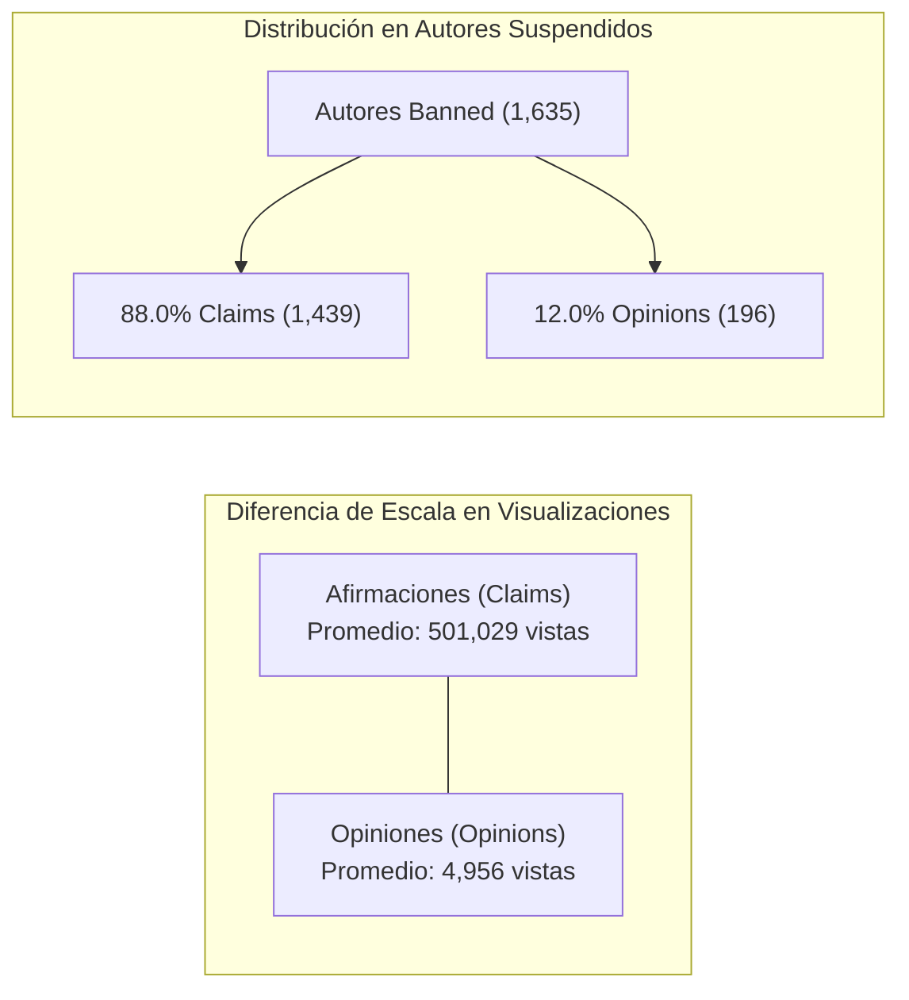

# TikTok Trust & Safety: Resumen Ejecutivo — Curso 1

[⬅ Volver al README del Proyecto](README.md) | [Documento de Trabajo (tiktok.md)](tiktok.md) | [Estrategia PACE](PACE_Strategy_Document_TikTok.md) | [Protocolo de Agentes](AGENTS.md)

**Fecha:** 09/09/2026  
**Elaborado por:** Científico de Datos Sénior — Equipo de Confianza y Seguridad (*Trust & Safety*)  
**Destinatarios:** Willow Jaffey (DS Lead), Rosie Mae Bradshaw (DS Manager), Mary Joanna Rodgers (PM Officer)  

---

## 1. Visión General del Proyecto (*Project Overview*)

### Contexto de Negocio
- **Cliente / Organización:** TikTok Inc. — División Global de Confianza y Seguridad (*Trust & Safety*).
- **Misión del Proyecto:** Automatizar el triaje inicial de los reportes masivos de videos denunciados por la comunidad, diferenciando con precisión entre **afirmaciones fácticas (*claims*)** y **opiniones personales (*opinions*)** para reducir drásticamente el retraso en la cola de revisión de los moderadores humanos.
- **Objetivo Estratégico:** Construir una canalización analítica y un modelo predictivo escalable que priorice la atención humana hacia afirmaciones verificables y potencialmente dañinas, optimizando la asignación de recursos operativos y salvaguardando la integridad de la comunidad de TikTok.

---

## 2. Inspección Preliminar de Datos (*Data Inspection & Quality*)

| Dimensión | Métrica / Hallazgo Cuantitativo |
| :--- | :--- |
| **Volumen Total** | **19,382 filas** y **12 columnas** registradas en `tiktok_dataset.csv`. |
| **Estructura de Datos** | **5 columnas numéricas continuas** (`float64`: conteos de vistas, likes, shares, downloads, comments), **3 enteras** (`int64`: índice `#`, `video_id`, `video_duration_sec`) y **4 categóricas/texto** (`object`: `claim_status`, `video_transcription_text`, `verified_status`, `author_ban_status`). |
| **Valores Faltantes (Nulos)** | **298 filas** (1.54% del total) con valores nulos exactamente sincronizados a lo largo de 7 columnas clave (`claim_status`, `video_transcription_text` y las 5 métricas de interacción). |
| **Anomalías Identificadas** | **0 valores negativos** detectados. `video_duration_sec` estrictamente dentro del rango de videos cortos (5 a 60 s). Fuerte asimetría positiva en métricas de engagement que revela presencia de videos hipervirales. |

---

## 3. Principales Conclusiones Iniciales (*Key Insights*)

> [!TIP]
> **Momento "¡Ajá!" del Análisis Preliminar:**
> *Los videos que contienen afirmaciones fácticas (`claim`) reciben en promedio **501,029 visualizaciones** —aproximadamente **100 veces más** que los videos de opinión (`opinion`), los cuales promedian apenas **4,956 visualizaciones**—. Además, el **88.0% de los videos publicados por creadores que terminaron suspendidos (`banned`) corresponden a afirmaciones**, demostrando que el contenido fáctico es el principal conductor de viralidad y el epicentro de las infracciones a las normas comunitarias.*

### Hallazgos Detallados:
1. **Equilibrio Óptimo de Clases en la Variable Objetivo:**
   Al excluir los 298 registros incompletos, el conjunto de datos cuenta con **9,608 afirmaciones (50.3%)** y **9,476 opiniones (49.7%)**. Esta distribución perfectamente balanceada constituye un escenario ideal para el entrenamiento de modelos de Machine Learning en cursos futuros, eliminando la necesidad de aplicar técnicas de sobremuestreo sintético (SMOTE) o ajuste de pesos por desbalance de clases.

2. **Propagación Viral Desproporcionada en Cuentas Infractoras:**
   La mediana de veces que un video es compartido en cuentas con autores suspendidos (`banned`) es de **14,468**, en cuentas bajo escrutinio (`under review`) es de **9,444**, mientras que en cuentas activas es de solo **437**. Esto demuestra empíricamente que los videos que violan las políticas alcanzan una tasa de difusión **33 veces superior** antes de ser sancionados, justificando plenamente un sistema de triaje automatizado ultrarrápido.

3. **Mayor Intensidad de Interacción en Afirmaciones (*Engagement Rates*):**
   Las tasas calculadas de interacción por visualización demuestran que las afirmaciones generan una respuesta más visceral de la audiencia en comparación con las opiniones:
   - **Tasa de Me Gusta (`likes_per_view`):** ~33.0% en afirmaciones vs ~22.0% en opiniones (~50% más de interacción relativa).
   - **Tasa de Compartidos (`shares_per_view`):** ~6.5% en afirmaciones vs ~4.3% en opiniones (~51% más difusión).
   - **Tasa de Comentarios (`comments_per_view`):** ~7.0% en afirmaciones vs ~4.6% en opiniones (~52% más debate).

4. **Sincronía Estructural en los 298 Registros Faltantes:**
   La pérdida de datos no es aleatoria (MNAR). Los 298 registros conservan el identificador (`video_id`), la duración y el estado del autor, pero carecen totalmente de transcripción y de métricas de interacción. Esto sugiere que corresponden a videos retirados preventivamente de la plataforma antes de que los sistemas de telemetría consolidaran las estadísticas.

---

## 4. Recomendaciones y Próximos Pasos (*Next Steps*)

Para la siguiente etapa del marco PACE (**Fase Analyze — EDA Profundo y Pruebas Estadísticas en Curso 2 y Curso 3**):

1. **Investigación de Calidad y Depuración (Data Hygiene):**
   - Aislar los 298 registros nulos sincronizados para los análisis estadísticos de engagement y modelado supervisado, documentando el protocolo de exclusión.
   - Contrastar con el equipo de ingeniería de datos el origen técnico de estos 298 registros para validar si corresponden a bajas por infracción inmediata.

2. **Ingeniería de Características y Preparación para Modelado:**
   - Aplicar transformaciones logarítmicas ($\log(1+x)$) sobre las métricas de interacción (`views`, `likes`, `shares`) para normalizar las distribuciones asimétricas antes de las fases de regresión y clasificación.
   - Enriquecer el análisis exploratorio en el Curso 2 con procesamiento lingüístico preliminar sobre `video_transcription_text` (conteo de palabras, longitud del texto, presencia de términos asertivos vs subjetivos).

3. **Gobernanza Ética y Definición de Métricas de Negocio:**
   - **Priorización de Métrica Recall:** Proponer a Willow Jaffey y Rosie Mae Bradshaw que la métrica de éxito del modelo sea el **Recall sobre la clase `claim`**. En *Trust & Safety*, un Falso Negativo (no enviar a revisión un video con una afirmación peligrosa) expone potencialmente a 500,000 usuarios a desinformación, mientras que un Falso Positivo solo genera una revisión adicional de una opinión inocua.
   - **Monitoreo de Equidad Algorítmica:** Diseñar pruebas de hipótesis (Curso 3) para evaluar si el estado de verificación de la cuenta (`verified_status`) influye indebidamente en la probabilidad de recibir denuncias, previniendo sesgos algorítmicos hacia creadores no verificados.
